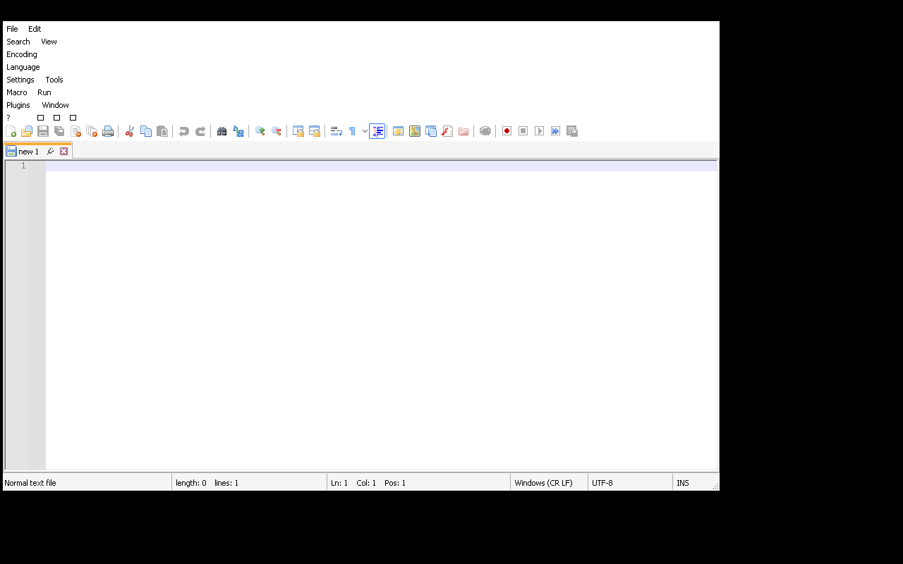
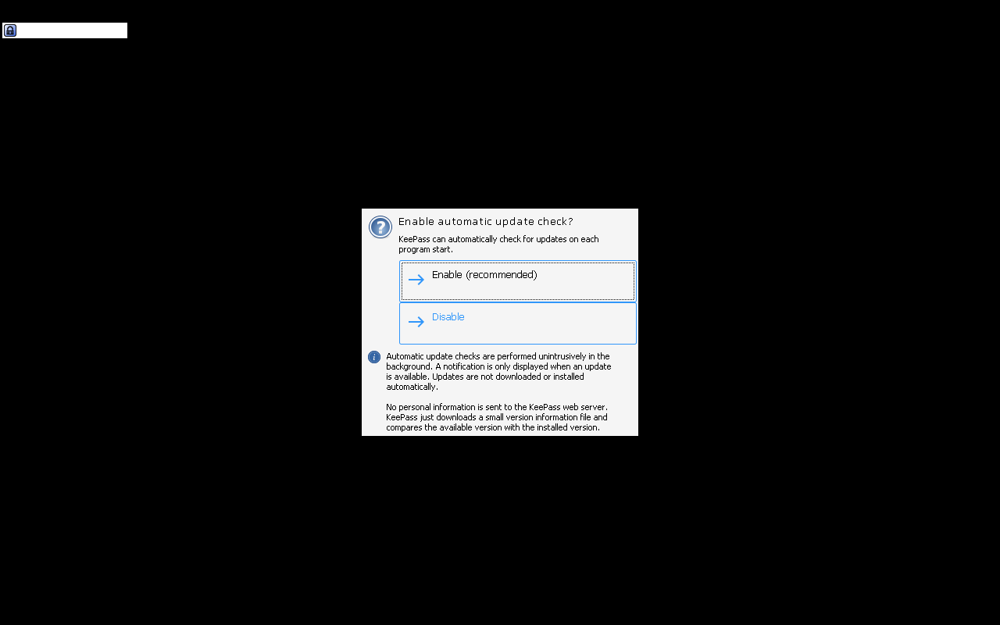
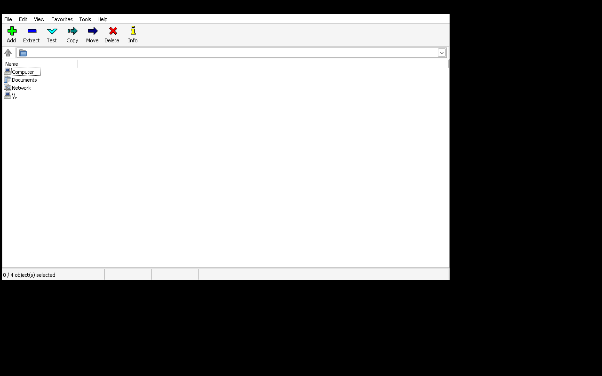
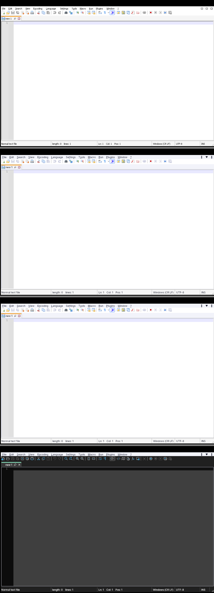
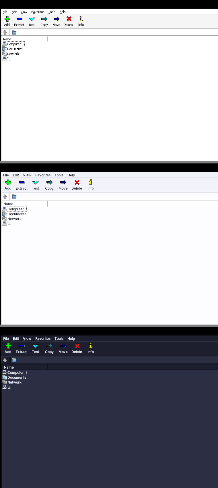
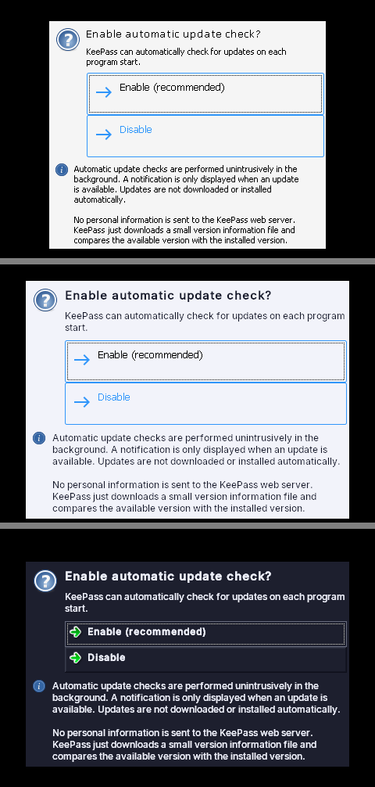
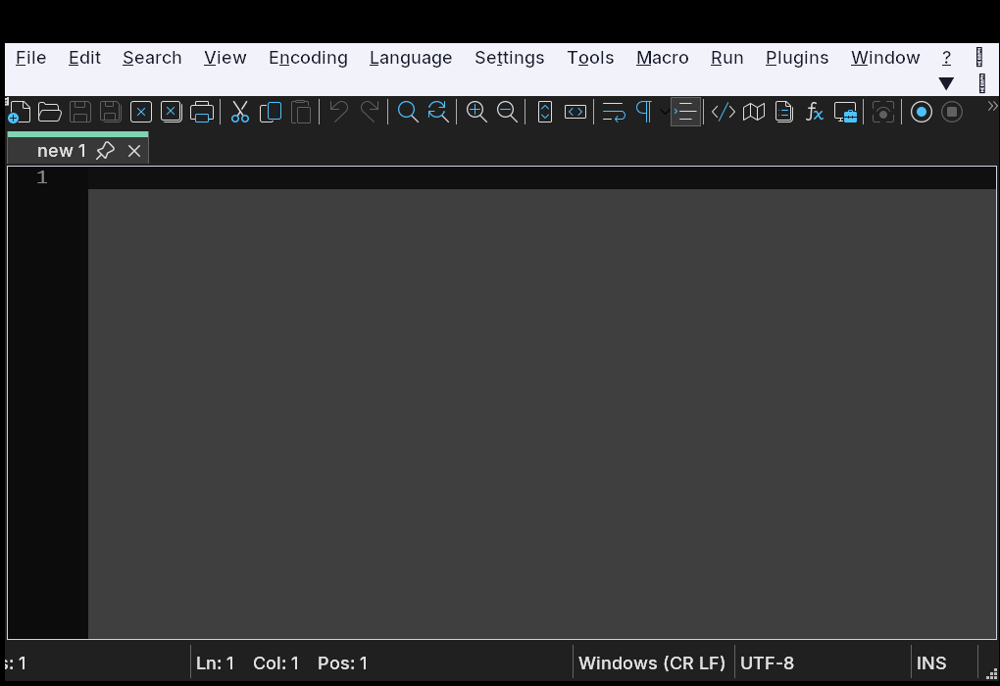

# Lucent Bridge

Double-click a Windows `.exe` or `.msi` on **Lucent OS** (Fedora Atomic + KDE Plasma) and it runs. No virtual machine, no telemetry, no AI, no ads.

> **Status: 0.2, tested end to end on real software.** Every push installs real Windows programs from their official downloads with real Wine (and, on ARM, real FEX x86→ARM translation) in Fedora 45 containers that carry the exact Lucent OS Wine package set, with the network switched off. See [Tested on real software](#tested-on-real-software). It has not yet run on physical Lucent OS hardware with a real GPU and a Plasma session; that is the next milestone.

## Tested on real software

[`.github/workflows/e2e.yml`](.github/workflows/e2e.yml) runs on every push, on `ubuntu-24.04` (x86-64) and `ubuntu-24.04-arm` (AArch64, 4 KiB pages):

1. A Fedora 45 image with **exactly** the Wine/FEX packages Lucent OS installs (piecewise `wine-core`…, never `wine-systemd`; on AArch64 Wine 11.21 ARM64EC + `fex-emu-wine` 2611 from COPR `lacamar/wine-arm64ec`), Xvfb, `xdotool`/`xprop`, Mesa llvmpipe/lavapipe.
2. Lucent Bridge is built **as the RPM**, offline from vendored crates, and installed with `dnf`.
3. Installers are downloaded from the vendors' official URLs and checked against pinned SHA-256s ([`ci/e2e/apps.tsv`](ci/e2e/apps.tsv)). The tests then run as a normal user with **`--network none`** on a btrfs home mounted `compress=zstd:1`, like Fedora Atomic's `/var/home`.
4. For each app ([`ci/e2e/tests.sh`](ci/e2e/tests.sh)): `lucent-bridge run --silent <installer>` → the generated `.desktop` entry must pass `desktop-file-validate` and have a PNG icon → the entry is started with `gio launch` (as the desktop would) → a window whose `WM_CLASS` equals the entry's `StartupWMClass` must appear → screenshot → close it with `WM_CLOSE` and wait for the process to exit.
5. Everything runs twice: once creating prefixes with `wineboot`, once from the [prefix template](#first-launch-prebuilt-prefix-template).

| Program (official download) | What it exercises | x86-64 | AArch64 (FEX) |
|---|---|---|---|
| Notepad++ 8.9.9 (`npp.8.9.9.Installer.x64.exe`) | 32-bit NSIS installer → 64-bit Win32 app | ✅ installs, launches from its entry, closes | ✅ installs, launches from its entry, closes |
| 7-Zip 26.06 (`7z2606-x64.exe`) | 64-bit custom installer (`silent_args` from the compat DB) → 7-Zip File Manager | ✅ | ✅ |
| KeePass 2.62 (`KeePass-2.62-Setup.exe`) | 32-bit Inno Setup → **.NET Framework WinForms** app on Wine Mono | ✅ (after the `iconv.dll` fix below) | ✅ (WinForms UI renders) |
| Direct3D 11 sample ([source](ci/e2e/d3d11-sample/d3d11_sample.c), built with MinGW in CI) | x86-64 D3D11 + HLSL via `d3dcompiler_47`, **DXVK** on lavapipe; checks the rendered pixels | ✅ DXVK 3.1.1 (bundled with Lucent Bridge, see [DXVK on x86-64](#dxvk-on-x86-64)) on lavapipe, on Xvfb's 0 Hz screen | ✅ DXVK 3.1.1 (ARM64EC build) on lavapipe |
| console program ([source](ci/e2e/d3d11-sample/hello.c)) | first-launch cost, `%USERNAME%`/`%USERPROFILE%` | ✅ | ✅ |

On AArch64 every one of these x86/x64 binaries runs through FEX inside Wine's ARM64EC/WoW64 layer (`HODLL64=libarm64ecfex.dll`, `HODLL=libwow64fex.dll`), so the primary translation path is proven on real installers. Wine Mono and Gecko install from the local packages on first launch with the network off: no dialogs, no downloads.

Screenshots from the AArch64 run (x86 code translated by FEX; the virtual screen has no window manager, so there are no title bars):

| Notepad++ | KeePass (.NET WinForms, first-run dialog) | 7-Zip File Manager | D3D11 via DXVK |
|---|---|---|---|
|  |  |  |  |

Runs: [E2E workflow](https://github.com/sidun-av/lucent-bridge/actions/workflows/e2e.yml). Every run uploads its screenshots, logs and the built RPMs as artifacts.

### First launch: prebuilt prefix template

Creating a Wine prefix (`wineboot --init`, which also installs Wine Mono and Gecko) takes seconds and writes 1.7 GB (x86-64) to 2.4 GB (AArch64: aarch64 + ARM64EC + i386 DLLs) per app. The OS image therefore ships a **prefix template** built once at image build time (`lucent-bridge build-template`, as root, into `/usr/share/lucent-bridge/prefix-template`). A program's first launch then copies it with `cp -a --reflink=auto` and makes it the user's: the profile directory and every registry reference to the placeholder user are renamed to `$USER`, and Documents/Desktop/Downloads/… are linked to the user's XDG folders by Wine's own rules. If the copy fails for any reason, `wineboot` runs as before. On btrfs the copy is a reflink, so each app's prefix shares its data with the template until the app changes it.

Measured in CI (first run of a console program in a brand-new prefix; prefix step / whole run):

| | `wineboot --init` | template copy | template, btrfs reflink (like Lucent OS) |
|---|---|---|---|
| x86-64 | 9.11 s / 9.1 s | 0.68 s / 1.0 s (overlayfs, plain copy) | **0.77 s / 1.3 s** |
| AArch64 | 7.57 s / 7.6 s | 4.71 s / 5.1 s (overlayfs, plain copy) | **1.39 s / 1.8 s** |

The figures vary by a few tenths between runs (another run: AArch64 7.68 s → 1.06 s). Building the template takes about 16 s (x86-64) / 15 s (AArch64). Installs get faster too, since the installer's prefix is ready sooner (Notepad++ 18.9 s → 6.6 s on x86-64).

## How it works

```
                     ┌───────────────────────────────────────────────┐
  setup.exe ──────▶  │ lucent-bridge                                  │
  (double-click,     │  1. inspect: PE machine, GUI/console, version, │
   binfmt, or CLI)   │     icon, installer type (Inno/NSIS/MSI/...)   │
                     │  2. compat DB lookup (env, DLL overrides, ...) │
                     │  3. pick a runner for host × program × tools   │
                     │  4. per-app prefix, winetricks verbs           │
                     │  5. run; after installers: launcher entries    │
                     └───────────────────────────────────────────────┘
```

| Host    | Program                  | Runner            | What executes the x86 code                    |
|---------|--------------------------|-------------------|-----------------------------------------------|
| x86-64  | x86 / x86-64 / MSI       | `wine`            | the CPU, directly. Wine translates API calls only |
| x86-64  | ARM64 / ARM64EC / ARM64X | unsupported       | (no ARM→x86 translation is shipped)           |
| AArch64 | x86 / x86-64 / MSI       | `wine-fex` (primary) | FEX JIT inside the process, via Wine's ARM64EC (x86-64) and WoW64 (x86) emulator interface |
| AArch64 | x86 / x86-64 / MSI       | `fex-interpreter` (fallback) | FEX JIT translating an x86-64 Linux Wine and everything under it |
| AArch64 | ARM64 / ARM64X           | `wine-arm64`      | native, nothing translated                     |
| AArch64 | ARM64EC                  | `wine-arm64`      | native, with FEX for any x86-64 parts          |

The selector (`src/runner.rs`) is a pure function and is tested over **every** combination of host, program architecture, Wine capabilities, FEX components, page size and preference (85,680 cases).

### The ARM mechanism: why ARM64EC/WoW64 + FEX DLLs is primary

As of late 2026, FEX-Emu (releases 2605–2611) puts most of its Windows work into the *Wine-integrated* path: FEX is built as a Windows DLL (`libarm64ecfex.dll` for x86-64, `libwow64fex.dll` for 32-bit x86). An ARM64 Wine built with `--enable-archs=arm64ec,aarch64,i386` loads it, the same way Windows 11 on ARM loads its own emulator. Wine picks the DLLs from the `HODLL64` and `HODLL` environment variables (the registry equivalents are `HKLM\Software\Microsoft\Wow64\amd64` and `\x86`). This is the upstreamed form of the Hangover approach, and Valve's ARM Proton work uses it too.

We chose it as the primary path because:

- **Only the program's own code is translated.** Wine itself (ntdll, win32u, the graphics/audio/input drivers) and the host's Mesa/Vulkan drivers run as native ARM64. ARM64EC is ABI-compatible with x64, so calls from translated code into system DLLs drop straight into native code.
- **No x86 Linux userland.** No x86-64 RootFS, no x86 Mesa, no library thunks to keep in sync with the host. The host GPU driver is used directly.
- **32-bit programs work without any 32-bit libraries.** WoW64 handles them.
- **It is where upstream is going.** Recent FEX releases fixed ARM64EC suspend handling, moved to a unixlib split, adopted CHPEv2 for WoW64 exceptions and added a JIT code cache that works under Wine.

What it costs: Lucent OS has to ship an ARM64EC-enabled Wine. We could not confirm one in the main Fedora repositories at the time of writing; the `lacamar/wine-arm64ec` COPR provides both Wine and `fex-emu-wine` for Fedora. FEX also recommends some Wine patches that are not upstream yet.

**Fallback: x86-64 Wine under `FEXInterpreter`.** This path works with any stock x86-64 Wine inside the FEX RootFS and is FEX's most mature mode. The price is that all of Wine and its Linux dependencies are translated too, and it needs a multi-gigabyte x86-64 RootFS. It is selected automatically when the primary path is incomplete (for example, Wine without ARM64EC), or on request (`--runner fex-interpreter`, or `runner = "fex-interpreter"` in a compat entry).

**16 KiB / 64 KiB page kernels** (Asahi Linux on Apple silicon, some server kernels): Wine and FEX need 4 KiB pages. The known workaround is a micro-VM with a 4K kernel, and that violates the no-VM rule. Lucent Bridge says so plainly and refuses to run.

## Usage

```sh
lucent-bridge inspect setup.exe            # what is this file? (--json, --extract-icon out.png)
lucent-bridge plan setup.exe               # dry run: the exact commands `run` would execute
lucent-bridge plan --assume-tools --host aarch64 setup.exe   # ...as on a stock ARM Lucent OS
lucent-bridge run setup.exe [-- args...]   # run it; installers get launcher entries afterwards
lucent-bridge run --silent setup.exe       # unattended install (switches from the compat DB or installer type)
lucent-bridge run --progress-fd 3 app.exe  # progress as JSON lines on fd 3, for a UI (see Launch sheet)
lucent-bridge list                         # installed apps (one prefix each)
lucent-bridge remove <app-id> [--yes]      # delete prefix, launcher entries, icons
lucent-bridge integrate <app-id>           # rescan a prefix for shortcuts
lucent-bridge build-template [DIR]         # (image build, as root) the prebuilt prefix template
```

`--silent` uses the compat entry's `silent_args`, else the installer type's standard switches (Inno Setup `/VERYSILENT /SUPPRESSMSGBOXES /NORESTART /SP-`, NSIS `/S`, MSI `/qn`, WiX Burn `/quiet /norestart`); an installer it doesn't know is refused rather than guessed. Set `WINEDEBUG` yourself to see Wine's diagnostics; otherwise they are silenced.

Messages, notifications and dialogs are in English, or in Russian when the locale says so (`LANGUAGE`, `LC_ALL`, `LC_MESSAGES`, `LANG`, as gettext reads them). Generated launcher entries carry both (`GenericName` and `GenericName[ru]`).

`plan` works on any OS (it is how development on macOS works). `run` needs Linux.

Example dry run of a 32-bit Inno Setup installer on ARM:

```
Lucent Bridge plan for IrfanView [irfanview-e9d5c050]
  Runner:    wine-fex — Wine ARM64EC/WoW64 + FEX (x86 → ARM translation)
  Prefix:    ~/.local/share/lucent-bridge/prefixes/irfanview-e9d5c050 (will be created)
  Compat:    IrfanView (matched by product name, status: works, from compat/apps.toml)
Steps:
  1. Create the Windows environment (first launch only)
     $ env HODLL=libwow64fex.dll HODLL64=libarm64ecfex.dll WINEDEBUG=-all WINEDLLOVERRIDES=winemenubuilder.exe=d WINEPREFIX=... /usr/bin/wine wineboot --init
  2. Install components: corefonts
     $ env ... WINE=/usr/bin/wine ... /usr/bin/winetricks -q corefonts
  3. Start IrfanView
     $ env ... /usr/bin/wine /home/me/Downloads/iview_setup.exe
  4. Add the installed program to the application launcher
  5. Wait for the installer to finish completely
     $ env ... /usr/bin/wineserver -w
  6. Add shortcuts created after the installer closed
```

### Double-click and `./setup.exe`

- `packaging/lucent-bridge.desktop` registers a hidden MIME handler for `application/x-ms-dos-executable`, `application/x-msdownload`, `application/x-msi` (and the newer `application/vnd.microsoft.portable-executable`). `packaging/mimeapps.list` makes it the default.
- `packaging/binfmt.d/lucent-bridge.conf` registers the `MZ` magic, so an executable `.exe` can be started from a shell. The interpreter is a symlink named `lucent-bridge-binfmt`. Invoked under that name, the binary acts as `lucent-bridge run -- <file>`.
- Progress and errors appear in the [launch sheet](#launch-sheet-and-progress-protocol) when one is installed, else through `notify-send` or `kdialog` when one of them and a graphical session exist (otherwise they are silently skipped; errors use a `kdialog --error` box, because after a double-click nothing else would be visible). "<App> is installed" is always a notification.

### Launch sheet and progress protocol

A first launch prepares a Windows environment (a ~1 s template copy, or ~9 s of `wineboot`), and a double-click with no visible reaction feels broken. So `run` reports what it does as **JSON lines** (protocol version 1, [`src/progress.rs`](src/progress.rs)):

```json
{"v":1,"event":"start","name":"Notepad++ Installer","file":"npp.8.9.9.Installer.x64.exe","size":7028968,"icon":"…/_source.png","installer":true,"program_arch":"x86-64","host_arch":"x86-64","translation":false,"first_launch":true}
{"v":1,"event":"step","step":"prepare"}
{"v":1,"event":"progress","fraction":0.42}
{"v":1,"event":"step","step":"launch"}
{"v":1,"event":"launched"}
{"v":1,"event":"installed","name":"Notepad++","entries":1}
{"v":1,"event":"exit","code":0}
```

Other events: `step` `components` (winetricks verbs, with `detail`), `error` (`kind`: `unsupported`, `blocked` — e.g. kernel-mode anti-cheat —, `hibernated` — the program is on the disk of a Windows that didn't shut down completely —, `open-failed`, `failed`; with translated `title`, `message`, `hints` and `can_run_anyway`), `cancelled`. Progress through a step of unknown length is eased: it rises quickly, slows down and never reaches the end before the step does.

- `run --progress-fd N` writes them to an inherited descriptor; the caller is the UI. SIGTERM/SIGINT during the preparation cancel cleanly.
- Otherwise, in a graphical session, `run` starts **`lucent-bridge-sheet`** (found on `PATH`, or `$LUCENT_BRIDGE_SHEET`; `none` turns it off) and writes them to its stdin, **only when there is something to show**: a first launch, components, an error. A program that is already set up starts with no sheet at all. The sheet answers with its exit status: `2` = Cancel (the run stops, and a Windows environment it had only begun to create is removed), `3` = "Run anyway" on a warning.

Lucent OS ships the sheet ([`apps/lucent-bridge-sheet`](https://github.com/sidun-av/lucent-os/tree/main/apps/lucent-bridge-sheet), PySide6, in its design, English and Russian). Without one, everything works as before.

### Programs start like on Windows: not as Administrator

Wine gives every process a token in which BUILTIN\Administrators is an *enabled* group — even the `TokenElevationTypeLimited` token that a program started from Linux gets (`server/token.c`, `token_create_admin`, Wine 11.20 and current master). So `CheckTokenMembership(Administrators)` is TRUE for everything, and programs that ask "am I elevated?" that way (the MSDN pattern; Notepad++ is one) believe they are, and say `[Administrator]` in their title. On Windows an administrator's ordinary programs run with the filtered token, where that group is deny-only.

`run` therefore starts ordinary GUI programs through **`lucent-start.exe`** ([`windows/lucent-start.c`](windows/lucent-start.c), built with MinGW, `/usr/share/lucent-bridge/windows/`), which makes exactly that filtered token (`CreateRestrictedToken`, Administrators → deny-only) and starts the program with it (`CreateProcessAsUserW`). Nothing that needs more loses it:

- **installers** (and MSI packages) are started directly, with the token they always had, so per-machine installs into Program Files are unchanged;
- a program whose **manifest asks for `requireAdministrator`/`highestAvailable`** is still elevated by Wine's loader through the linked full token, as UAC would;
- console programs keep their terminal (they start directly).

The E2E proves all three with a test program that shows what it sees in its title (`admins=0 elevated=0` as a program, `admins=1 elevated=1` with a requireAdministrator manifest, `admins=1` as an installer), and checks that Notepad++, 7-Zip and KeePass don't say "[Administrator]". `LUCENT_BRIDGE_START_HELPER=none` restores 0.1's behaviour. On AArch64 the helper is an x86-64 program too (Fedora has no AArch64 MinGW), so it runs through FEX for the moment it takes to start the program and wait for it.

### Windows programs look at home

Before each launch (while no `wineserver` has the prefix open — otherwise at the next one), `run` writes the desktop's look into the prefix's registry ([`src/appearance.rs`](src/appearance.rs), [`src/regfile.rs`](src/regfile.rs)):

- **Light or dark**, read from the desktop's colour scheme (`kdeglobals`' window background, as Plasma's portal decides), with Windows system colours taken from Lucent's *Pebble Drift* design tokens, and Windows' own "apps use light theme" switch that dark-mode-aware programs follow. Light keeps Wine's flat Aero visual style; Wine has no dark visual style, so dark draws classic controls, whose bevels the palette keeps soft.
- **The desktop's UI font** (Figtree on Lucent since its Pebble Drift restyle; Inter before) for dialogs (`MS Shell Dlg`, `MS Shell Dlg 2`), `Segoe UI`, menus, message boxes and status bars (9 pt, as Windows 10/11). Carefully: Wine applies a substitute only to names that aren't installed fonts, so the font must exist (checked with fontconfig, else nothing changes); and Wine builds its fallback font links for "MS Shell Dlg" only when it maps to a face it knows, so the UI font gets explicit links for characters it lacks: Inter first when the UI font is another one (Figtree has no Cyrillic; Plasma falls back to Inter too), then Tahoma. Dialogs are laid out in dialog units derived from the font's average character width, so they grow with a wider font instead of clipping it.
- **DPI** from the Plasma scale factor: `Xft.dpi`, which KWin gives X11 programs that scale themselves (96 × scale), else KWin's recorded Xwayland scale, else 96.
- **Smooth, readable text**: ClearType (RGB, or BGR when Plasma says so; grayscale when Plasma's sub-pixel rendering is off) with a gamma that darkens dark-on-light edges in light mode and brightens light-on-dark ones in dark mode, and the Medium face for body text (the design's weight 500): Wine's grayscale mode leaves Inter's 12 px stems light grey.

`LUCENT_BRIDGE_APPEARANCE=off` leaves the prefix alone (`light`/`dark` force a mode); `LUCENT_BRIDGE_DPI` forces a DPI; `LUCENT_BRIDGE_UI_FONT` picks the font. A compat entry with `colors = "light"` keeps the light palette for a program that mixes fixed light colours with the system's (Notepad++: its light theme draws the active tab label in black over the system colours); Windows' dark-mode switch still follows the desktop for it.

Screenshots from the x86-64 E2E ([run 42683248645](https://github.com/sidun-av/lucent-bridge/actions/runs/42683248645); Xvfb without a window manager, so no title bars), top to bottom: Wine's own look (the pass with `LUCENT_BRIDGE_APPEARANCE=off`), light, dark; for Notepad++ also with its own "Follow Windows" dark mode on (its menu bar stays light: Notepad++ paints a dark menu bar through undocumented `WM_UAHDRAWMENU` messages that Wine doesn't send). Then Notepad++ at Plasma's 150 % (Xft.dpi 144).

| Notepad++ | 7-Zip File Manager | KeePass (first-run dialog) |
|---|---|---|
|  |  |  |



### DXVK on x86-64

Fedora 45 ships DXVK 2.7.1 only (f45, updates, updates-testing and rawhide checked on 2026-11-09), whose swap chain divides by the display's refresh rate unguarded: on a display that reports 0 Hz (Xvfb, some virtual and remote displays) every Direct3D 10/11 program dies. DXVK 3.x guards it. The x86_64 RPM therefore carries the **upstream DXVK 3.1.1 release** (zlib licence, [`packaging/dxvk/`](packaging/dxvk/), checked against a pinned SHA-256), and `run` copies its DLLs into each prefix (64-bit into `system32`, 32-bit into `syswow64`, as DXVK's `setup_dxvk.sh` does) with `WINEDLLOVERRIDES` preferring them; a compat entry can still choose otherwise. `build-template` puts them into the template, so prefixes made from it get them as btrfs reflinks. AArch64 keeps the ARM64EC DXVK that comes with its Wine.

### Per-app prefixes and launcher entries

Each program gets its own Wine prefix at `$XDG_DATA_HOME/lucent-bridge/prefixes/<app-id>`. The app ID is a readable slug of the product name plus 8 hex digits of a SHA-256 over product and company, e.g. `notepadplusplus-1f0c9a2e`. It stays the same across versions, and two vendors' "Editor" programs get different prefixes. A program that lives inside a prefix (the one an installer just put there) always runs in that prefix.

Wine's own menu builder is disabled (`winemenubuilder.exe=d`), so Wine doesn't litter the menu with `wine-*` entries. When the installer exits, and again once nothing runs in the prefix any more (`wineserver -w`: installers that hand off to a child process and exit early), Lucent Bridge:

1. reads the `.lnk` shortcuts it created (Start menu, Public desktop; symlinked desktops are never followed), plus any Wine-generated `.desktop` files that belong to this prefix;
2. maps their targets into the prefix (case-insensitively, as Windows does), skips uninstallers, documents and missing targets, and de-duplicates;
3. extracts each program's icon (largest image of the first icon group, PNG or BMP) to PNG;
4. writes spec-quoted `lucent-bridge-<app-id>-<name>.desktop` files with `StartupWMClass` set so the Plasma task manager groups windows correctly, and removes the Wine-generated entries it replaced.

### Compatibility database

TOML, built-in entries in `compat/`, plus `/usr/share/lucent-bridge/compat.d`, `/etc/lucent-bridge/compat.d` and `~/.config/lucent-bridge/compat.d` (later files win). Entries match by SHA-256, then product name, then file name:

```toml
[[app]]
name = "Adobe Photoshop CS6"
match.product = ["Adobe Photoshop CS6"]
match.exe = ["Photoshop.exe"]
status = "unknown"                      # works | partial | broken | unknown
verbs = ["vcrun2010", "msxml6", "atmlib", "gdiplus"]   # winetricks, once per prefix
dll_overrides = { msxml6 = "native,builtin" }
env = { SOME_VAR = "1" }
runner = "fex-interpreter"              # optional AArch64 preference
silent_args = ["/S"]                    # for `run --silent`, when the installer type's defaults don't fit
native_alternative = "flatpak: ..."     # suggested instead, if it exists
notes = "Shown to the user."
```

Every entry is validated: environment variable names, override syntax, verb names (no shell injection) and hash format. `status = "broken"` blocks the launch with the entry's explanation, for example for kernel anti-cheat; `run --force` tries anyway. A status other than `unknown` needs evidence: the `works` entries are the programs the end-to-end tests install and start on both architectures; everything else stays `unknown` until it has been tested.

## Status: what works and what doesn't

**Implemented and tested**

- PE inspection: i386 / x86-64 / ARM64, plus ARM64EC and ARM64X (detected through the load-config CHPE pointer); GUI vs console; .NET; DLLs. Version resources (language-aware), group icon → PNG, Inno Setup / NSIS / WiX Burn / InstallShield / MSI / name heuristics. The reader is bounds-checked everywhere and fuzzed by truncation in the tests.
- Runner selection, plans and execution, per-app prefixes, compat DB, `.lnk` parsing, desktop integration, `list` / `remove` / `integrate`.
- `run` against a *fake* Wine in the unit/CLI tests (right commands, environment, order), and against **real Wine and FEX with real installers** in the E2E workflow (see above), on both architectures.

**Bugs the real runs found (all fixed, with regression tests)**

- Fedora ≥ 43 builds Wine in new-WoW64 mode and installs its DLLs under `/usr/lib64/wine-wow64/wine/*-windows`; detection only knew the old layouts, so *every* program was refused on both architectures. Wine library directories are now discovered, not listed.
- KeePass's Inno Setup shortcut (as Wine writes it) has a NUL as its arguments; it ended up as a literal NUL argument in the launcher entry. `.lnk` strings now end at the first NUL and the desktop writer drops control characters.
- Hints said `rpm-ostree install wine`, which pulls `wine-systemd` (a competing `MZ` binfmt handler); they now name `wine-core`. The RPM requires `wine-core` and `wine-mono` and conflicts with `wine-systemd`.
- `run` forced `WINEDEBUG=-all`, hiding why a program failed; a `WINEDEBUG` you set is now respected.
- Found by Lucent OS's [x86_64 acceptance test](https://github.com/sidun-av/lucent-os/blob/main/.github/workflows/acceptance.yml) (the installed ISO, a real Plasma session, Notepad++'s installer double-clicked), fixed in 0.1.1 and 0.1.2:
  - `build-template` refused to run without `HOME`, so Lucent OS's `lucent-bridge-template.service` (a system service) never built the template on a real boot. It needs nothing of a user's and now runs without one.
  - (0.1.2) A prefix copied from the template kept the template's SELinux labels (`var_lib_t`, from `/var/lib/lucent-bridge`) in the user's home: `cp -a` copies them as an extended attribute, even with `--no-preserve=context`. On SELinux systems the new prefix is now `restorecon`'d (≈0.1 s), so it is `data_home_t` like the rest of `~/.local/share`.
  - Launcher entries were added only after `wineserver -w`, i.e. after *every* program in the prefix had exited. Notepad++'s installer starts Notepad++ on its last page ("Run Notepad++", checked by default), so the program wasn't in the launcher, and the "installed" notification didn't come, until the user closed it. Entries are now added as soon as the installer exits, and again once the prefix is idle.
  - (0.2.0) Notepad++ said `[Administrator]` in its title: Wine's tokens always have the Administrators group enabled (see [Programs start like on Windows](#programs-start-like-on-windows-not-as-administrator)).
- (0.2.0) Direct3D 10/11 died on x86-64 on a 0 Hz display with Fedora's DXVK 2.7.1 (an unguarded division by the refresh rate); the bundled DXVK 3.1.1 renders.
- (0.2.0, from the E2E's own screenshots) Wine's grayscale anti-aliasing left Inter's 12 px stems light grey on light backgrounds, and a caption colour equal to the window surface made Notepad++'s active tab label disappear in dark mode (Notepad++ draws it in `COLOR_ACTIVECAPTION`). Text now uses ClearType with a per-mode gamma and the Medium face; captions use the accent.

**Not yet verified / known gaps**

- **Not yet run on physical Lucent OS hardware** (real GPU). Lucent OS's acceptance test runs it in a real Plasma session in a VM; the E2E screen here has no window manager, which is why there are no title bars in its screenshots.
- A program that an **installer starts on its last page** ("Run Notepad++") inherits the installer's administrator token, as it does on Windows, so that one instance still says `[Administrator]`; started from its launcher entry it doesn't.
- **Dark mode** colours the parts of a program that Windows' system colours and visual style draw. A program with its own colours keeps them: Notepad++'s editor stays white unless its own dark mode is on (its "Follow Windows" dark-mode option reads the same `AppsUseLightTheme` setting Lucent Bridge writes; not tested here). Wine has no dark visual style, so dark mode draws classic (bevelled, softened) controls.
- **Fedora's new-WoW64 Wine can't find MinGW system DLLs** (it is built without `--with-system-dllpath`), so Wine Mono can't load `iconv.dll` and every .NET program exits silently on x86-64. Lucent Bridge links the MinGW `iconv.dll` into each x86-64 prefix (`src/sysdlls.rs`); KeePass works with it. The real fix belongs in Fedora's `wine` package.
- On AArch64, `wineboot` prints `failed to start ... sysarm32\rundll32.exe` (no 32-bit ARM support in the COPR Wine); harmless.
- MSI packages are named after their file name; the MSI SummaryInformation stream isn't parsed yet.
- winetricks verbs are not applied on the `fex-interpreter` runner (it would need winetricks itself running under FEX).
- For image-based FEX RootFS (SquashFS/EroFS), the x86-64 Wine inside can't be auto-detected. Set `LUCENT_BRIDGE_FEX_GUEST_WINE=/usr/bin/wine`. Other overrides: `LUCENT_BRIDGE_WINE`, `LUCENT_BRIDGE_FEX_DLL_DIR`, `LUCENT_BRIDGE_FEX_INTERPRETER`.
- Icons are written as absolute-path PNGs, not into the hicolor theme.
- `remove` deletes the prefix; it doesn't run the program's own uninstaller.

**Won't work, by design or by nature**

- **Kernel-mode anti-cheat and DRM** (Riot Vanguard; Easy Anti-Cheat / BattlEye where the developer hasn't enabled Linux support). Wine can't load Windows kernel drivers, and nothing short of running Windows can.
- **Windows drivers of any kind**: vendor printer/scanner drivers, USB dongles, VPN clients, hardware tools, file-system filters.
- Explorer shell extensions, Microsoft Store/UWP apps.
- **ARM programs on x86-64 PCs.** There is no ARM→x86 translation.
- **x86 vs ARM differences:** on AArch64, x86 code runs through a JIT. Expect lower CPU performance than native, a slower first start while code is translated (FEX's code cache shortens later starts) and occasional emulation-specific bugs. ARM64 Windows builds of a program, when they exist, run natively and are preferable. Kernels with 16 KiB pages are refused (see above).

## Building and testing

```sh
cargo build --release
cargo test                 # unit + CLI tests; the fake-Wine `run` tests are Linux-only
cargo clippy --all-targets -- -D warnings
```

Every unit-test fixture (PE files with resources and icons, `.lnk` shortcuts) is generated in-process by `src/testpe.rs`. No third-party binaries are in the repository; the E2E tests download theirs from the vendors and check pinned hashes.

- `.github/workflows/ci.yml`: `cargo fmt --check`, `clippy -D warnings`, `cargo test`, `desktop-file-validate`, on x86-64 and AArch64.
- `.github/workflows/e2e.yml`: the real-software tests described above.
- `.github/workflows/release.yml`: on a `v*` tag, builds the RPMs for x86_64 and aarch64 in Fedora 45 containers **with the network disabled** (vendored crates, `ci/rpm/`), and publishes them with the source tarball, the vendor tarball, the SRPM and `SHA256SUMS` as a GitHub release.

## Installing on Lucent OS (for the image build)

Releases: <https://github.com/sidun-av/lucent-bridge/releases>. Each has `lucent-bridge-<v>-1.fc45.{x86_64,aarch64}.rpm` and a `SHA256SUMS` file covering every asset. The OS image should:

1. Download the RPM for its architecture and check it against the `SHA256SUMS` from the same release; `dnf install` the file (unsigned local RPMs install with `dnf`; plain `rpm -i` on Fedora 45 refuses them without `--nosignature`).
2. Install Wine piecewise, never the `wine` metapackage (it pulls `wine-systemd`): `wine-core wine-common wine-winefonts wine-mono` (+ `mingw64-wine-gecko mingw32-wine-gecko` on x86_64), and on aarch64 `fex-emu fex-emu-wine` from COPR `lacamar/wine-arm64ec`.
3. If it installs `wine-dxvk`: switch the `wine-d3d*`/`wine-dxgi` alternatives to DXVK afterwards ([`ci/e2e/enable-dxvk.sh`](ci/e2e/enable-dxvk.sh)). Fedora's `wine-dxvk` decides its priority by running `vulkaninfo` in `%posttrans`; in an image build there is no GPU, so DXVK silently loses to wined3d on every machine.
4. Run `lucent-bridge build-template` (as root, after Wine and DXVK are final) to create `/usr/share/lucent-bridge/prefix-template`.
5. Optionally install a `lucent-bridge-sheet` program on `PATH` (Lucent OS: `apps/lucent-bridge-sheet`) to show first-launch progress and explanations; see [Launch sheet](#launch-sheet-and-progress-protocol). The x86_64 RPM brings its DXVK and `lucent-start.exe` itself.

## Principles

- **No virtual machines.** Programs run on the real CPU: directly on x86-64, through FEX's x86→ARM translation on AArch64.
- **No telemetry, no network access, no ads, no AI.** Lucent Bridge makes no network connections of its own, and a first launch needs none (Wine Mono and Gecko come from local packages, which the tests check with the network off). winetricks downloads only the components a compat entry lists.
- **Honest failures.** If something can't work, the user is told why in plain language, and what would fix it.

## Кратко (на русском)

Lucent Bridge запускает программы Windows на Lucent OS двойным щелчком, без виртуальных машин:

- **На x86-64** программа выполняется процессором напрямую, а Wine переводит вызовы Windows API в вызовы Linux. Эмуляции нет.
- **На ARM (AArch64)** x86-инструкции программы переводятся в ARM с помощью **FEX-Emu**. Основной путь: Wine для ARM64 с поддержкой ARM64EC/WoW64 и DLL-эмуляторами FEX (`libarm64ecfex.dll`, `libwow64fex.dll`). Транслируется только код самой программы, а Wine, драйверы и графика работают нативно. Запасной путь: x86-64 Wine целиком под `FEXInterpreter`.
- У каждой программы свой префикс Wine (`~/.local/share/lucent-bridge/prefixes/<app-id>`). Когда установщик заканчивает работу, программа появляется в меню Plasma со своей иконкой.
- **Что не работает:** античиты уровня ядра (Riot Vanguard и подобные), драйверы Windows (принтеры, донглы, VPN-клиенты), всё, что требует загрузки кода в ядро. Ядра с 16K-страницами (например, Asahi на Mac) не поддерживаются: обходной путь там — виртуальная машина, а её мы сознательно не используем.
- Статус: версия 0.2. При каждом изменении CI ставит настоящие программы (Notepad++, 7-Zip, KeePass на .NET, пример Direct3D 11) с официальных сайтов в настоящий Wine, а на ARM ещё и через FEX, без доступа к сети. На реальном железе с Lucent OS пока не проверялось.
- Первый запуск: префикс копируется из готового шаблона (`cp --reflink`), на ARM это 1 с вместо 7,7 с. Пока среда готовится, показывается спокойное окно «Подготовка Windows-программы» с прогрессом и кнопкой «Отмена» (`lucent-bridge-sheet`; прогресс — JSON-строки, `run --progress-fd`). Там же — понятные объяснения: античит уровня ядра, программа на диске Windows, которая не была полностью выключена.
- Программы запускаются как в Windows у администратора с UAC — без прав администратора (Notepad++ больше не пишет `[Administrator]`); установщики и программы, которым права нужны по манифесту, их получают.
- Программы выглядят как дома: светлая или тёмная тема рабочего стола (цвета Pebble Drift), шрифт Inter, DPI по масштабу Plasma, сглаживание ClearType.
- На x86-64 в пакете — DXVK 3.1.1 (в Fedora 45 только 2.7.1, который падает на дисплеях с 0 Гц).
- Сообщения на английском, а при русской локали на русском.

## License

Apache-2.0. See [LICENSE](LICENSE).
